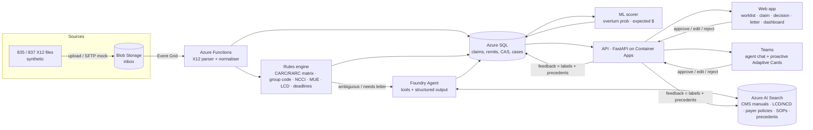

# Claims Denial Navigator: POC Plan

**Status:** draft for internal review before the partner meeting · **Owner:** Alif Consulting
**Scope:** a working demo on realistic synthetic data. No real PHI goes into the POC.

---

## 1. What Microsoft's reference repo actually does

Repo: `microsoft/RHAIL-Claims-Denial-Navigator` (v1.0, March 2025). It is a **Power Platform solution**, not application code.

```
SharePoint library (upload 835/837 .txt)
  → Power Automate "MainProcessFlow" (on file created)
      → split 835 on CLP segments, then per claim:
          → Azure OpenAI parses the raw X12 text into JSON   ← LLM used as a parser
          → Dataverse: ClaimResponse, ServiceLine, ClaimAdjustmentCode, RARC rows
          → per CAS (CARC) adjustment:
              → Azure OpenAI chat + "On Your Data" (Azure AI Search over blob docs:
                payer guides + SubmittedUserFeedback.txt), temperature 0, max_tokens 1000
              → HTML recommendation + citations stored in Dataverse
  → Model-driven Power App: worklist, claim screen, recommendation, feedback, rating
  → "AddFeedback" flow: appends the user's note to one blob .txt file, then re-runs the indexer
```

Assets worth reusing: the Dataverse data model (Claim, ClaimResponse, ServiceLine, ClaimAdjustmentCode, Citation, Payer, CodeDefinition), `data/rhail_codedefinitions.csv` (about 1,485 CARC/RARC definitions: 393 CARC, 1,092 RARC), the 835 parsing JSON shape, and the prompt pattern (CARC + RARC + payer → steps).

### Gaps (this is where our value is)

| # | Gap in v1.0 | Why it matters to a hospital | What we do instead |
|---|---|---|---|
| 1 | **The LLM parses X12.** The FAQ admits the JSON gets truncated. | Non-deterministic, and a dropped CAS segment is a missed denial. | Deterministic X12 5010 parser with 100% field accuracy, unit tested. |
| 2 | Recommendations key only on **CARC + RARC + payer name**. | Generic advice. It ignores CPT/HCPCS, ICD-10, modifiers, dates, the ABN modifier, NCCI edits and LCDs, which is where the real root cause sits. | Rules and edit checks plus claim context are passed to the agent as tools. |
| 3 | **No decision.** The output is free HTML. | Billers need a routed action: resubmit, appeal, bill secondary, bill patient, write off, or no action. | Structured JSON decision with a closed action enum, owner queue, deadline and confidence. |
| 4 | No triage or priority. Every CAS row is treated the same, including CO-45 contractual adjustments and PR-1 deductibles. | Noise. Most 835 adjustments are not workable denials. | A noise filter, then an ML-ranked worklist by expected recoverable $ × urgency. |
| 5 | **No deadlines.** | Appeal and timely-filing windows are the most common reason money is lost for good. | Deterministic deadline engine per payer type. |
| 6 | Feedback is appended to one text file and re-indexed. | Doesn't scale, can't be audited, and pollutes retrieval. | Structured "resolved case" records, retrieved as precedents and used as ML labels. |
| 7 | No evaluation harness. | No way to prove accuracy to a CFO. | Golden test set, automated evals and an accuracy report (see `TEST_CASES.md`). |
| 8 | API keys sit in environment variables, and it needs a Power Apps premium licence for each user. | Security review friction and per-user cost. | Managed identity, Key Vault and Entra ID SSO, with web and Teams front ends. |

**Pitch line:** *"Microsoft gave rural hospitals a free starting point. We turn it into a decision engine you can measure, with a deterministic core, ML prioritization and a grounded AI agent, in Teams and on the web."*

---

## 2. The core decision: which AI approach?

You asked: Copilot front door plus Foundry? An added ML model? A fine-tuned cheap model like Qwen? The honest answer is **all three have a role, in different layers. None of them should decide alone.**

Denial resolution is mostly a **knowable** problem. Group code semantics, CARC/RARC meaning, NCCI pairs, LCD covered diagnoses and appeal windows are published facts and rules. Accuracy comes from **getting the facts deterministically and grounding the language**, not from a smarter model.

### Recommended design: rules first, ML ranks, LLM explains, human approves

| Layer | Technology | Decides | Why this layer |
|---|---|---|---|
| **L1 Deterministic** | Python on Azure Functions | Parsing, code lookups, group-code liability (CO/PR/OA/PI), noise filtering, NCCI/MUE/LCD checks, deadlines, the action for clear-cut cases | 100% reproducible and auditable. Covers most volume. |
| **L2 ML** | LightGBM on Azure ML, registered model | Probability the denial is overturned, expected recovery $, worklist priority. In phase 2, *pre-submission denial risk* on 837s. | Ranking is a tabular problem. Gradient boosting beats LLMs there and costs nothing to run. |
| **L3 Agent** | **Microsoft Foundry Agent Service** + Azure AI Search | Root-cause explanation, step plans for ambiguous cases, appeal letter drafts, Q&A, citations | Language and long-tail reasoning, grounded in CMS manuals, payer policies and precedents, called through tools. |
| **L4 Human** | Web app and Teams | Approve, edit or reject. Feedback becomes labels. | Required for appeals and write-offs. Builds trust and training data. |

### Option verdicts

| Option | Verdict | Reasoning |
|---|---|---|
| **Foundry agent + AI Search (RAG + tools)** | ✅ **Core of the POC** | Azure-native and inside the partner's tenant, which supports the "no data leaves" promise. Built-in evaluations and tracing. Can be published to Teams and Microsoft 365 Copilot from the same agent. Model-swappable. |
| **Copilot Studio as the front door** | ⚠️ Optional skin | A good fit if the partner is a Power Platform shop, since it aligns with the Microsoft repo. But it is weak for queue-based tabular work, and its logic is harder to version and test. Use it only as a Teams chat layer that calls our Foundry agent and API. |
| **A classic ML model** | ✅ **Add it, for ranking and prediction only** | Don't ask ML to "choose the action". Rules do that more reliably. Ask it *which denials to work first* and, later, *which claims will be denied before you send them*. |
| **Fine-tuned Qwen or another SLM** | ❌ Not in the POC. ✅ Phase 3 option. | (a) There are no labeled outcomes yet. (b) Policy changes all the time: CARC/RARC updates several times a year, NCCI quarterly, LCDs continuously. Knowledge baked into weights goes stale, while RAG does not. (c) Mini-tier hosted models are already cheap at these volumes. (d) Self-hosting adds GPU, PHI-hosting and MLOps burden. **When it makes sense:** high-volume, narrow classification at scale, or a data-sovereignty or on-prem demand. Then distill from verified agent outputs plus human labels into Phi or Qwen, deployed through Foundry models or Foundry Local. Keep a model abstraction from day one so this is a config change later. |

**Model choice (confirm against regional availability at build time):** a mini-tier GPT model for triage and explanation, and a full-size model for appeal-letter drafting. Use structured outputs with a JSON schema and temperature 0 for decisions.

---

## 3. Target POC architecture



**Agent tools (function calling):** `get_claim(claim_id)`, `get_remit_adjustments(claim_id)`, `lookup_code(code)`, `check_ncci(cpt_a, cpt_b, dos)`, `check_mue(hcpcs, units, dos)`, `check_lcd(hcpcs, icd10[], state, dos)`, `compute_deadline(payer_type, event, date)`, `search_policies(query, payer)`, `find_precedents(carc, rarc, payer, hcpcs)`, `draft_appeal(claim_id, basis)`, `create_work_item(claim_id, action, queue)`.

**Event-driven decisions after a denial:** a new 835 → parse → filter noise → rules decision → ML score → agent enrichment (only where needed) → work item routed to a queue (Coding, Registration/Eligibility, Utilization Review/Auth, Credentialing, Patient Accounts, Appeals) → a Teams card if high $ or a near deadline → human approves → mock "resubmit 837 (freq 7)" or "generate appeal PDF" → outcome tracked → feedback.

**Security baseline:** Entra ID SSO, managed identity everywhere (no API keys), Key Vault, App Insights + Foundry tracing, Content Safety prompt shields (claim notes are untrusted input), synthetic data only. Private endpoints and BAA review come in the pilot phase.

**Delivery:** one `azd up` template (Bicep), so the partner can redeploy it in their own subscription.

**Rough POC run cost:** AI Search Basic, Azure SQL serverless, Container Apps consumption, Functions consumption and low token volume. Expect **low hundreds of USD per month**. Validate with the pricing calculator once SKUs are fixed.

---

## 4. Mock data: realistic and from public sources

**Rule:** everything is synthetic or public. Fictional hospital, fictional payers and fictional patients. No real payer branding in generated files.

### 4.1 Sources

| Need | Public source | Use |
|---|---|---|
| Patients, encounters, diagnoses, procedures | **Synthea** (open source; the CMS synthetic Medicare PUF is built on it) | Clinically coherent claim lines |
| Medicare claim distributions | **CMS Synthetic Medicare Enrollment, FFS Claims & PDE PUF** (data.cms.gov) and **DE-SynPUF** | Calibrate service mix, charges and DOS spread for a rural Critical Access Hospital (CAH) |
| CARC / RARC | X12 code lists (the MS repo CSV already holds them) | Codes on the 835 and definitions |
| ICD-10-CM / PCS | CMS / CDC annual files | Diagnoses |
| HCPCS Level II, PFS / OPPS rates | CMS | Procedures and allowed amounts. **CPT descriptors are AMA-licensed**, so use codes without long descriptors, or HCPCS-heavy scenarios. |
| NCCI PTP edits and MUEs | CMS quarterly files | Inject realistic bundling (CO-97 / M15 / M80) and unit-limit denials |
| LCD / NCD | CMS Medicare Coverage Database download | Medical-necessity denials (CO-50 / N115 / N386) and RAG corpus |
| Policy corpus for RAG | CMS IOM 100-04 *Claims Processing Manual* (incl. Ch. 29 Appeals), 100-02 *Benefit Policy*, state Medicaid provider manual (pick the partner's state, e.g. Texas or Washington to match the TORCH/WSHA rollout), plus **our own fictional commercial payer policy PDFs** | Grounding and citations |
| Provider identity | NPPES (taxonomy codes only) | Fictional NPIs with a valid Luhn check digit, verified not to exist in NPPES |

### 4.2 Synthetic world

- **Hospital:** *Prairie Ridge Community Hospital*, a fictional 25-bed CAH with a rural health clinic. Institutional (837I) and professional (837P) billing.
- **Payers (fictional):** Medicare FFS (mock MAC), State Medicaid (mock), a Medicare Advantage plan, two commercial plans.
- **Volume:** about 300 synthetic patients and **about 1,200 claims** over 6 months, with an **~18% denial rate** (the rural benchmark cited in Microsoft's announcement), giving about 215 denied claims.
- **Denial mix (our assumption, to calibrate):** eligibility/registration 25%, missing info/coding 20%, authorization 15%, medical necessity 15%, bundling 10%, timely filing 5%, duplicate 5%, other (credentialing, frequency, benefit max) 5%. Plus *non-denial* adjustments on every paid claim (CO-45, PR-1/2/3, OA-23) as noise.

### 4.3 Data factory pipeline (code in `poc/data-factory/`)

1. Run Synthea with a rural-state config, and export encounters, conditions and procedures.
2. Map encounters to claims (837I/837P), assign payers and price them from PFS/OPPS.
3. **Denial injector:** about 20 scenario templates (see `TEST_CASES.md`). Each template mutates the claim to create the root cause (drops the rendering NPI, uses a non-covered ICD-10 for an LCD-governed HCPCS, bills an NCCI pair without a modifier, submits after 12 months, etc.). It then writes the matching CAS/RARC on the 835 and records the **ground-truth label**: root cause, correct action, owner queue, deadline and required documents.
4. Write valid **X12 5010** 837 and 835 files (envelope, BPR/TRN, CLP, CAS, SVC, LQ) and validate them with the parser round-trip.
5. Outputs: `data/synthetic/x12/*.txt`, `data/synthetic/labels.parquet`, `data/synthetic/ehr_docs/*.pdf` (mock auth letters, ABN forms, op notes for appeals), and `data/corpus/` for RAG.

Because the injector creates the root cause, **every denial has a known correct answer**. That is what makes the demo provable.

---

## 5. Front end: web app first, Teams second

Denial work is a **queue**, and queues are tables. Chat alone is the wrong primary UX, so we ship both, on the same API and agent.

**Web app (React or Next.js + FastAPI, Entra ID SSO):**
1. **Worklist:** denied claims ranked by ML priority, with $ at risk, days to deadline, action badge and queue filters.
2. **Claim detail:** the 837 vs 835 side by side, CAS lines in plain English, the rules checks that fired (NCCI ✓/✗, LCD ✓/✗, auth on file?) and the **decision card** (action, why, steps, documents, deadline, confidence, citations).
3. **Appeal studio:** an agent-drafted letter with citations. Edit, approve, export PDF.
4. **Feedback:** approve, override (with reason) or rate. Overrides become labels and precedents.
5. **Dashboard:** denial rate by category and payer, $ recovered vs at risk, aging, top root causes, and a "prevention opportunities" view.

**Teams (Foundry agent published to Teams / Microsoft 365 Copilot):**
- Chat: *"Top 10 denials by dollars due this week"*, *"Why was claim PRH-10423 denied?"*, *"Draft the Medicare redetermination for it"*.
- Proactive **Adaptive Card** to the right queue channel when a denial is over $X or within N days of its deadline, with *Approve plan* / *Open in app* buttons.

---

## 6. Expected output contract

Every workable denial produces one record (schema in `poc/agent/decision.schema.json`):

```json
{
  "claim_id": "PRH-10423",
  "payer": "Medicare FFS (mock MAC)",
  "adjustments": [{"group": "CO", "carc": "50", "rarc": ["N115"], "amount": 412.00, "line": "HCPCS 93306"}],
  "is_workable_denial": true,
  "root_cause": "ICD-10 I10 is not in the LCD's covered diagnosis list for 93306; chart documents R06.02 (shortness of breath), which is covered.",
  "action": "CORRECT_AND_RESUBMIT",
  "owner_queue": "CODING",
  "steps": [
    "Review the echo order and physician note for the documented indication",
    "Add the supported diagnosis (R06.02) as primary on the line",
    "Submit corrected claim / reopening per MAC rules"
  ],
  "required_documents": ["Physician order", "Progress note with indication"],
  "deadline": {"type": "REOPENING_CLERICAL", "due_date": "2027-03-14", "rule": "1 year from initial determination"},
  "priority": {"overturn_probability": 0.82, "expected_recovery": 338.00, "score": 91},
  "citations": [{"source": "LCD Lxxxxx – Transthoracic Echocardiography", "section": "ICD-10 Codes that Support Medical Necessity"}],
  "decided_by": "RULES+AGENT",
  "confidence": 0.88,
  "needs_human_review": true
}
```

**Closed action set:** `CORRECT_AND_RESUBMIT`, `SUBMIT_NEW_CLAIM`, `REOPENING`, `APPEAL_REDETERMINATION` (or the commercial equivalent `APPEAL_LEVEL_1`), `OBTAIN_RETRO_AUTH`, `BILL_PRIMARY_THEN_SECONDARY`, `BILL_SECONDARY`, `BILL_PATIENT`, `ROUTE_CREDENTIALING`, `WRITE_OFF`, `NO_ACTION`.

---

## 7. Plan in batches

The estimates assume **2 engineers + 1 RCM/billing SME (part-time)**. Batches overlap. **Batches 0–3 plus the Batch 4 web slice form the "meeting MVP"**: a working end-to-end demo in about 2 weeks. Batches 5–6 make it pilot-grade.

### Batch 0: Foundations (days 1–2)
- Azure subscription and resource group. Microsoft Foundry project with model deployments (mini + full) and quota confirmed. AI Search, SQL, Storage, Key Vault, App Insights. All through `azd` + Bicep.
- Repo scaffold: `poc/{data-factory,parser,rules,ml,agent,api,web,teams,evals,infra}`.
- An architecture decision record (ADR) capturing §2, signed off internally.
- The SME confirms the scenario list and action taxonomy.
- **Exit:** `azd up` deploys empty infrastructure, and a model call works through managed identity.

### Batch 1: Synthetic data factory (days 2–5)
- Load code sets (CARC/RARC from the MS CSV, ICD-10, HCPCS, NCCI, MUE, a curated LCD subset of about 10 LCDs covering the scenarios).
- Synthea run, claim mapping, pricing, **denial injector** (20 templates), X12 837/835 writer and ground-truth labels.
- Mock EHR documents for appeals (auth letters, ABNs, notes).
- **Exit:** about 1,200 claims and their 835s, with a labels file. 100% of files parse. The SME spot-checks 20 random denials as "realistic".

### Batch 2: Deterministic core (days 4–8)
- X12 835/837 parser (segments → typed objects), validated by the round-trip against Batch 1.
- Normalizer to SQL (schema extends the MS Dataverse model with `decision`, `work_item`, `deadline`, `feedback`).
- **Rules engine:** a versioned `carc_rarc_actions.yaml` matrix, group-code liability logic, a noise filter, NCCI/MUE/LCD checkers, a deadline engine (Medicare: redetermination 120 days from receipt of the initial determination, 12-month timely filing, 1-year reopening for clerical errors; Medicaid and commercial: from config per payer).
- **Exit:** parser tests pass. On the golden set the rules engine alone reaches the target for clear-cut cases (see `TEST_CASES.md` §4). Deadlines are 100% exact.

### Batch 3: Knowledge + agent (days 6–10)
- RAG corpus in AI Search: chunked CMS manuals, LCDs, the state Medicaid manual, fictional payer policies, SOPs. Hybrid + semantic ranking, with metadata filters for payer, state and effective date.
- Foundry agent: system prompt, the tools in §3, structured output against `decision.schema.json`, and an appeal-letter drafter.
- Prompt-injection hardening: claim free text goes to the model as data, behind Content Safety prompt shields.
- **Eval harness** (Foundry evaluations + custom evaluators): action accuracy, groundedness, citation validity, schema validity, latency and cost per claim.
- **Exit:** the eval report meets the targets in `TEST_CASES.md` §4 on the golden set.

### Batch 4: Front ends + event flow (days 8–13)
- Event Grid → Functions pipeline (drop an 835 and the worklist updates live, which is the demo "wow" moment).
- FastAPI and the web app: worklist, claim detail, decision card, appeal studio, feedback.
- Teams: publish the agent, add the proactive Adaptive Card for high-$ or near-deadline denials.
- **Exit:** the demo script (§8) runs end to end, twice, from a clean deploy.

### Batch 5: ML prioritization + learning loop (days 11–15)
- Features: payer, CARC/RARC, group code, $ amount, service line, days since DOS or denial, rule results, provider, and historical overturn rate. Labels: synthetic outcomes from the injector, with noise added so it is not trivially separable.
- LightGBM overturn-probability and expected-$ model in Azure ML, with a model card. Priority = P(overturn) × $ × urgency.
- The feedback loop: overrides become labels and **precedent documents** in the index, and the agent cites them ("similar case resolved on 2026-…").
- **Optional phase-2 teaser:** a pre-submission denial-risk score on 837s, *before* they go out. This is the prevention story CFOs care about most.
- **Exit:** the model card is published. Prioritized $ recovery beats a FIFO worklist in a back-test on synthetic data, and we state clearly that this is synthetic.

### Batch 6: Hardening + partner pack (days 14–17)
- Side-by-side **baseline comparison**: deploy the Microsoft v1.0 solution on the same 835s (optional, if Power Platform is available) and compare action accuracy, deadline coverage and noise handling.
- Accuracy report, a security one-pager (data flow, identity, no PHI), a cost sheet and a recorded fallback video.
- **Exit:** a dry run with an internal "CFO" and an "RCM director" persona.

### Batch 7: After the POC (proposal to the partner)
- **Pilot on real data** in the partner's tenant under their BAA: de-identified historical 835s/837s and appeal outcomes. Retrain ML on real labels.
- Integrations: clearinghouse (835 retrieval, 837 resubmission, 276/277 claim status), EHR work queues (Epic/Cerner/MEDITECH via FHIR or HL7, or flat files).
- Prevention: 837 scrubber + denial-risk model.
- SLM distillation (Phi or Qwen) for high-volume triage if cost or sovereignty requires it.
- Packaging as a repeatable Alif offering for rural networks (multi-tenant, with per-hospital indexes).

---

## 8. Demo script (8–10 minutes)

1. **The problem (1 min):** the dashboard shows Prairie Ridge with $X at risk, 18% denials and N claims within 30 days of a deadline.
2. **Live ingestion (1 min):** drop a fresh 835 into the inbox. The worklist updates within seconds and noise (CO-45, PR-1) is filtered out automatically.
3. **Clear-cut case (1.5 min):** CO-16 + MA130 (missing rendering NPI). Rules decide *Submit new claim, no appeal rights*, with the fix highlighted and one click to approve.
4. **Hard case (2.5 min):** CO-50 + N115 on an echo. The agent checks the LCD, finds a covered diagnosis in the chart and recommends a corrected claim. It shows citations to the LCD section, and the deadline is computed.
5. **Appeal (1.5 min):** CO-197 where the auth *was* on file. The agent drafts the appeal letter with the auth number and citations, the user edits and approves, and a PDF is produced.
6. **Teams (1 min):** a proactive card for a $9k denial due in 6 days. Ask the agent in Teams, *"what are my top 5 by dollars?"*
7. **Learning (0.5 min):** a biller overrides a decision, and the next similar claim cites that precedent.
8. **Proof (1 min):** the eval report shows accuracy, groundedness, deadline exactness and cost per claim.

---

## 9. Risks and mitigations

| Risk | Mitigation |
|---|---|
| The synthetic data looks fake to RCM experts | An SME reviews the scenario templates, and the claim mix is calibrated to the CMS synthetic PUF |
| The LLM hallucinates policy | Rules decide the clear-cut cases. The agent must cite a retrieved source or set `needs_human_review`, and a groundedness eval gates releases. |
| CPT licensing | HCPCS-heavy scenarios, codes without AMA descriptors, and the partner's own licence in the pilot |
| Payer rules vary by state and contract | Payer config files plus a metadata-filtered RAG corpus. The POC states which payers and states are modelled. |
| "Accuracy" claims on synthetic data are over-read | Every metric is labelled *synthetic*, with the real-data pilot proposed as the proof step |
| Model or region availability | Model abstraction and config-driven deployment names |

## 10. What we need to start

1. An Azure subscription (or the partner's sandbox) with Owner on one resource group, plus Foundry model quota for a mini and a full GPT deployment.
2. An Entra app registration rights holder, and a Teams tenant where we can sideload apps.
3. A part-time RCM/billing SME (internal or from the partner) for scenario validation.
4. A decision on the partner's state, to choose the Medicaid manual for the corpus.
